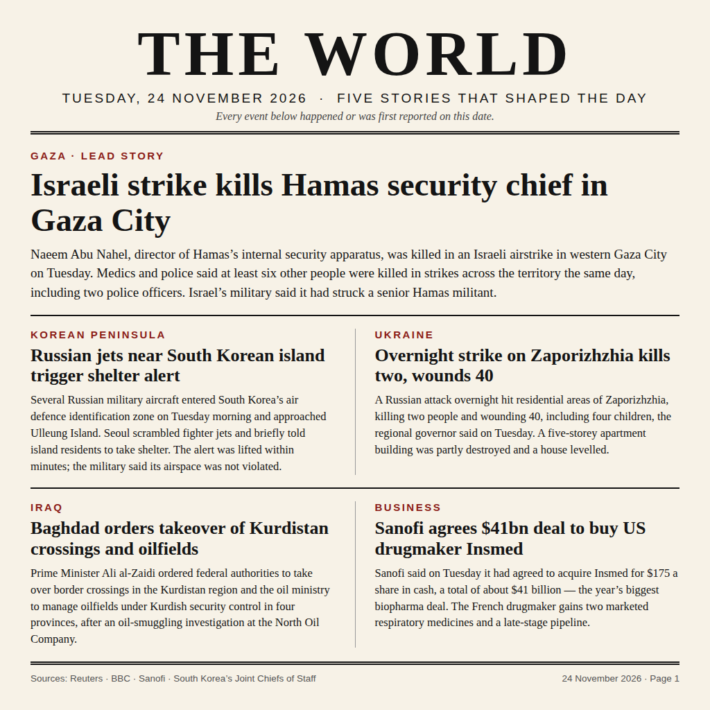

# The World — Tuesday 24 November 2026

[](https://make.fun/bounty/news-image-20261124)
[](https://make.fun/bounty/news-image-20261124)
[](https://make.fun/bounty/news-image-20261124)

A newspaper front page summing up Tuesday 24 November 2026 in five stories,
each checked against live reporting to confirm it happened or was first
reported on that exact day.



## The five stories

1. **Gaza — Israeli strike kills Hamas security chief in Gaza City.**
   Naeem Abu Nahel, director of Hamas's internal security apparatus, was killed
   in an airstrike in western Gaza City; at least six others died in strikes
   across the territory the same day. (Reuters, 24 Nov 2026)
2. **Korean Peninsula — Russian jets near South Korean island trigger shelter alert.**
   Several Russian military aircraft entered South Korea's air defence
   identification zone and approached Ulleung Island; Seoul scrambled jets and
   briefly told residents to take shelter. (Reuters, 24 Nov 2026)
3. **Ukraine — Overnight strike on Zaporizhzhia kills two, wounds 40.**
   A Russian attack on residential areas killed two people and wounded 40,
   including four children, the regional governor said. (Reuters, 24 Nov 2026)
4. **Iraq — Baghdad orders takeover of Kurdistan crossings and oilfields.**
   Prime Minister Ali al-Zaidi ordered federal authorities to take over border
   crossings and the oil ministry to manage oilfields in four provinces after an
   oil-smuggling probe. (Reuters, 24 Nov 2026)
5. **Business — Sanofi agrees $41bn deal to buy US drugmaker Insmed.**
   Sanofi announced it would acquire Insmed for $175 a share in cash, the year's
   biggest biopharma deal. (Sanofi press release, 24 Nov 2026)

Stories from earlier days that appeared in 24 November roundups — the ICJ
Myanmar genocide ruling (19 Nov), the COP31 collapse (22 Nov), the US measles
elimination loss (17 Nov), the Nvidia CEO reinstatement (23 Nov) and the
BepiColombo Mercury arrival (21 Nov) — were deliberately left out.

## How the image was made

The front page is hand-written HTML and CSS (`index.html`) — every word on the
page is text I wrote, typeset in a classic newspaper style. It was rendered to
a 1024×1024 PNG with headless Chromium, so the type stays crisp, and checked
visually at full size and at 300px wide. `main.ts` (Node 22, standard library
only) copies `entry.png` to the output directory.

## Run

```sh
node main.ts   # writes entry.png to $MAKEFUN_OUTPUT_DIR (default /output)
```

---

Built for the [news-image-20261124](https://make.fun/bounty/news-image-20261124?ref=1kbmej5w) bounty on make.fun.
